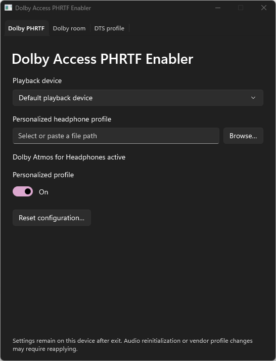
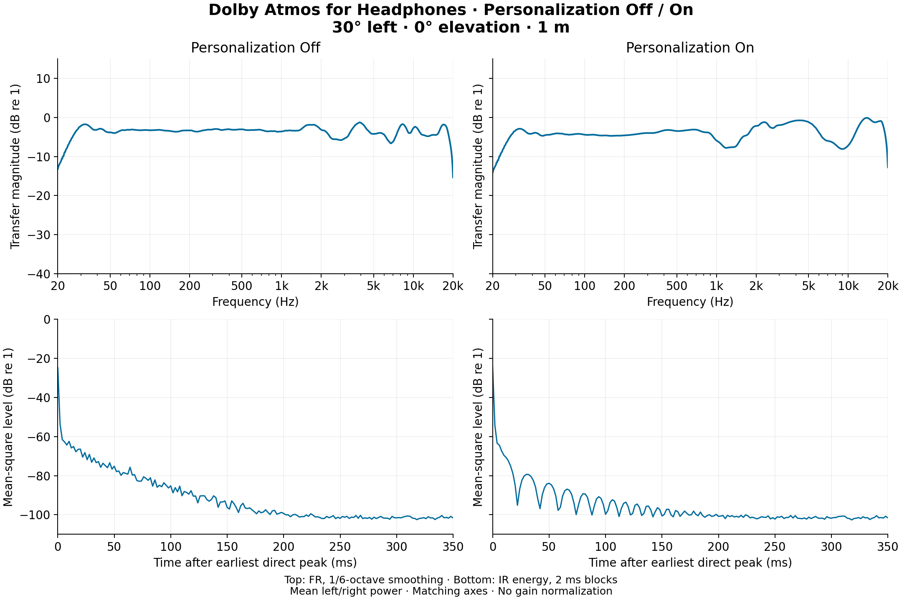
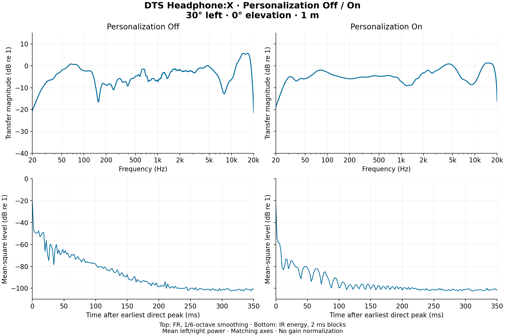
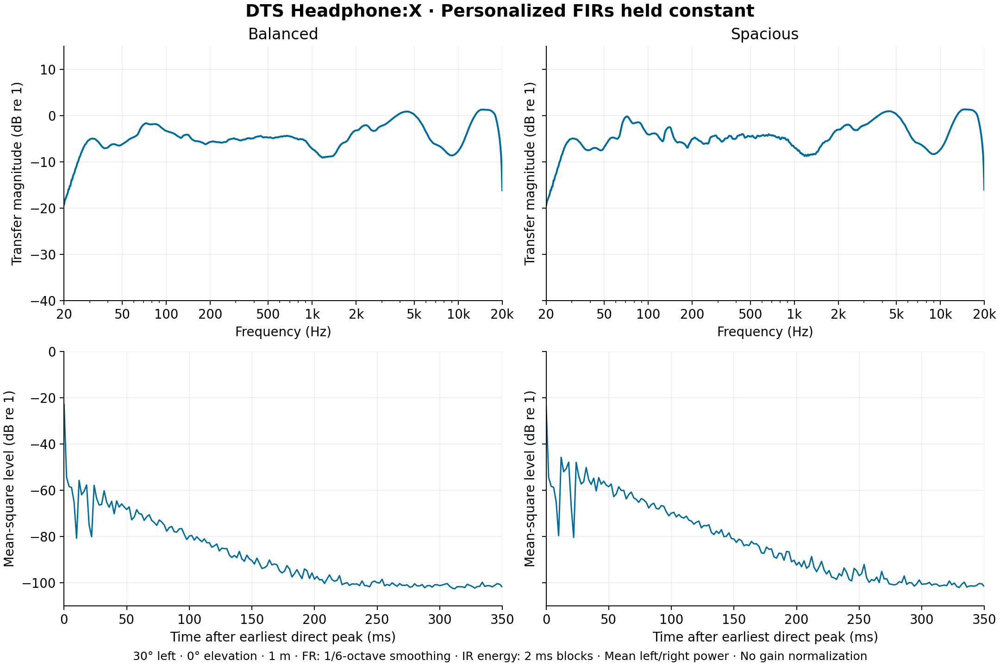
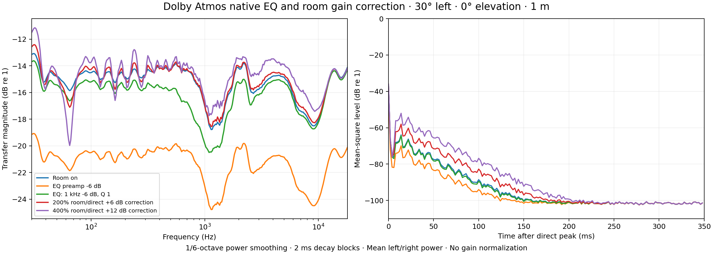
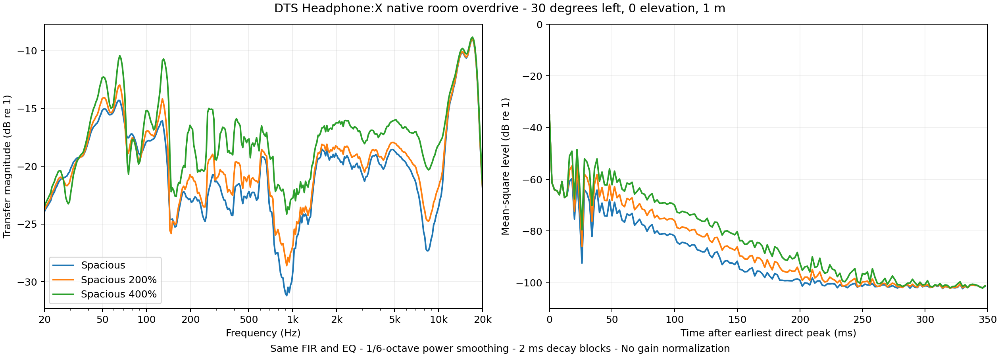

# Dolby Access PHRTF Enabler

Load personalized headphone profiles into **Dolby Atmos for Headphones** or **DTS Headphone:X** on Windows, with native room controls and automatic backups.

Version **2.2.0** fixes Dolby room controls when no personalized Atmos profile is applied. Built-in tuning is read from the installed Dolby Access package; a personal HRTF is not required. The window now resizes and fits smaller displays, and EQ import controls remain disabled during operations.

Compared with the previously published 2.0 release, this version also includes native Atmos/DTS headphone EQ, saved parametric EQ profiles, time-aligned SOFA interpolation, DTS Spacious 200%/400%, and optional gain correction for Dolby 200%/400%. [Release notes](release-notes.md) · [Regression requirements](../regression.md).

## Run

Download the portable EXE from the [latest release](https://github.com/aaronth07/Dolby-Access-PHRTF-Enabler/releases/latest), or extract the Windows x64 folder ZIP and run `DolbyAccessPhrtfEnabler.exe`. The portable launcher verifies its bundled files and extracts them under `%LOCALAPPDATA%\AtmosProfile\cache`. Application runtimes and the SOFA converter are included.

Requirements: Windows 10/11 x64, an active playback endpoint, and an installed, activated copy of Dolby Atmos for Headphones or DTS Sound Unbound. The app can enable the selected spatial provider; it does not activate vendor licenses.

## Dolby Atmos

1. Close Dolby Access and select the playback device.
2. Choose a `.personalized_headphone` profile. Valid contents are accepted regardless of extension.
3. Use **Enable Atmos** if offered, then turn **Personalized profile** On.

The toggle applies or restores the profile. Selecting a different valid file while On applies it immediately. Off returns the profile saved before the first import; this can itself be a personalized profile. Backups are automatic. Status refreshes on device/tab selection and after actions.

In **Dolby room**, select On, Off, 50% feedback, 200% room/direct, 400% room/direct, or Custom. **Room output level** scales the room output taps from 0-150% of their original value, subject to the native coefficient range. **Feedback** scales the recursive feedback from 0-100%, independently of output level. Feedback is not a calibrated decay-time setting. PHRTF apply defaults room processing On unless a previous app preference exists. Ordinary room changes preserve directional coefficients and reapply PHRTF if the saved baseline replaces it.

The experimental **200% / 400% room/direct** modes halve or quarter directional fields (-6.02 / -12.04 dB), while retaining saved room taps and feedback. **Gain correction** optionally adds +6 or +12 dB through native Atmos EQ, combined with the uploaded EQ. It defaults Off; the experimental confirmation includes the clipping warning. Apply requires confirmation. Repeated Apply and switching modes use the saved full-gain reference; On, Restore, and reset remove the attenuation. Both built-in Dolby tuning and personalized profiles are supported; the installed room must contain room output. The retained beta.1 native virtual-endpoint recordings confirm the corrected direct level and increased room return; see the measurement status. Custom 150% scales room taps alone.

## DTS Headphone:X

1. Select the playback device and binaural SOFA file, then **Verify and convert**.
2. Enable DTS if offered. Choose **Original**, **Balanced**, **Spacious**, **Spacious 200%**, **Spacious 400%**, or **Off** under **Room preset**.
3. Click **Apply profile**, or turn **Custom DTS profile** On.

Room changes preserve personalized FIRs and the panner, and write the combined profile and transaction notification together. Original restores room sends saved before the first DTS change. Balanced/Spacious are extracted from the installed DTS Sound Unbound package; vendor preset binaries and decoding keys are not bundled. The verified mapping is for Sound Unbound 2026.3.31.0 and the compatible 23-node Windows headphone grid. Spacious 200% and 400% multiply the actual native Spacious sends by two and four without changing feedback, FIRs, or the panner. Both require an experimental clipping confirmation. If mapping is unavailable, an explicit override retains Original room sends instead of guessing a named preset.

Applying a SOFA defaults to disabling the endpoint's DTS headphone-correction filters. If you have selected an uploaded profile in **Headphone EQ**, later SOFA and room changes retain it. The app warns when it detects vendor correction filters active. Off or **Restore** returns the saved runtime profile, device EQ, and counter. Changing a vendor EQ/profile can replace the injected configuration, so reapply afterward.

The converter accepts binaural SimpleFreeFieldHRIR and GeneralFIR with a full-sphere grid, one source distance, and integer sample delays. It resamples to 48 kHz and offers **Time-aligned** or **Linear** spatial interpolation. Time-aligned blends align neighboring direct arrivals, interpolate their arrival times separately for each ear with shared directional weights, and preserve full tails. Exact measured nodes retain their original response with one common delay. Ambiguous arrival differences over 2 ms keep the linear blend. Linear retains the previous conversion behavior. Conversion details report dimensions, sample rate, delay, target grid, and native format-validation result. Error details explain rejected inputs. Status reports the selected provider and custom profile state, rather than claiming to verify installation.

## Headphone EQ preview

Import an Equalizer APO parametric text file in **Headphone EQ**, select the saved profile and playback device, then **Apply EQ**. The graph includes the file's preamp gain. **EQ off** removes the uploaded EQ. Dolby room gain correction, if enabled, remains active. Resetting DTS restores the original device EQ; Dolby reset restores room settings and removes room gain correction while preserving the separate uploaded EQ. Saved profiles remain available separately from device backups.

The importer supports preamp, peaking, shelving, pass, notch, all-pass and band-pass filters, including Q, octave bandwidth and shelf slope forms. The current native route runs at 48 kHz. Unsupported routing directives such as Include and Channel produce an import error. The app does not edit Equalizer APO's configuration. DTS applies the exact supported biquad cascade within native processing, including room output. Atmos uses an adaptive 20-band native magnitude approximation with 1/16 dB target resolution; approximation error is reported before applying difficult curves. All-pass phase cannot be represented by Atmos EQ and is rejected. Sonic research is kept on a separate development branch.

## Persistence, reset, and overrides

Settings remain on the selected device after exit. Audio reinitialization, device recreation, and vendor profile changes may require reapplying. The app does not run a background monitor.

Backups are stored in `%LOCALAPPDATA%\AtmosProfile\<device GUID>`. Each write retains a transaction snapshot, while the original restore point is kept separately.

- **Reset configuration** restores saved Dolby room fields, clears Dolby state and backups, and saves the current personalized profile as the new Off baseline. DTS is preserved.
- **Reset DTS configuration** restores the saved DTS runtime profile, EQ and counter, then clears DTS conversions and backups. Dolby is preserved.

Both resets require confirmation in the app. Unfamiliar versions, external configuration changes, and damaged backup records offer explicit overrides where structurally valid data can be preserved. Invalid backup records are retained locally. Unknown encoder versions skip private native calls under override; malformed coefficient framing, checksums, or unsafe room edits are still rejected.

## Recorded comparisons

These are matched native spatial-object recordings at 30 degrees left, 0 degrees elevation, 1 m. Frequency response uses mean left/right power with 1/6-octave smoothing; impulse-response energy uses 2 ms blocks. Axes match and no gain normalization is applied. The measurements demonstrate renderer behavior for the tested profiles, rather than personal fit or listening quality.

The earlier DTS Off/On comparison used muted room sends. Version 2.0 restores them by default.

The room comparison changes only the first native stereo auxiliary vectors. Personalized FIR bytes are identical. Across the researched directions, Spacious increased 20-250 ms energy by approximately 9.8 dB relative to Balanced. Original runtime, transaction counter, configuration, and device defaults were restored in the source experiment. [Graph provenance](graph-provenance.json) records inputs and hashes without distributing the private recordings.

## Documentation and build

- [User guide](user-guide.md)
- [Technical report](report.md)
- [Release notes](release-notes.md)
- [Project site](index.html)
- [Build and test guide](development.md)

The application is C# / WinUI 3, unpackaged and self-contained. Build with .NET SDK 10, Windows SDK, and MSVC for the native helper/portable launcher. Native tests cover one Windows system; property readback and format checks do not establish acoustic output on every driver.

Release packages exclude personal profiles, raw captures, registry exports, endpoint identifiers, account data, and vendor preset/DLL files. Dolby and DTS names identify third-party products; this is an independent utility.

When moving from the separate 200% / 400% experimental build, use Restore there before applying a profile in version 2.2.0. Production and experimental builds keep separate restore records but share device audio settings.

### Missing or unfamiliar Dolby initialization

Atmos can be active without a saved personalized initialization property. Select the profile and turn Personalized profile On; **Allow anyway** initializes the selected device after saving its original state. Off restores that state, including an originally absent property. Unfamiliar initialization framing can also be replaced by explicit override; the original bytes remain in the automatic backup. The active Atmos status is reported separately from profile compatibility.
